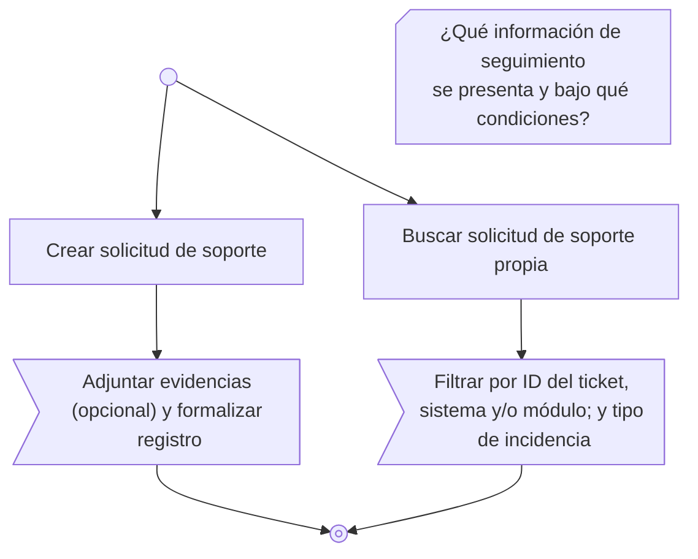

# Work Action Diagram

**Responsabilidad documental:** VSlices Docs Standard.  
**Estado:** definición inicial candidata, derivada del diagrama interno de «Registro y seguimiento» de Serviu (2026-11-10).  
**Conceptos representados:** [Work Flow](../../../mechanisms/domain-modeling/concepts/work-flow.md), según [Domain Modeling](../../../mechanisms/domain-modeling/README.md).  
**Navegación:** [Diagramas](README.md).

## Definición

Un **Work Action Diagram** es una representación examinable de **qué acciones, alternativas y relaciones internas reconocemos al realizar un Work Flow**, y de cómo se comprende su inicio y eventual término. Puede emplearse tanto para investigar el comportamiento como para **explicarlo mejor a otras personas**.

Su objeto es el **comportamiento dentro de un Work Flow**; no la coordinación entre Work Flows de un Work Process. No redefine las acciones organizacionales, no determina la implementación técnica y **no es obligatorio** para considerar comprendido un Work Flow.

## Simbología y convenciones de lectura

La realización inicial distingue **acciones primarias** y **acciones incluidas** mediante símbolos con significado documental. Son categorías de representación del comportamiento, **no nuevos tipos de entidad de Domain Modeling** ni correspondencias automáticas con `System Action`.

| Elemento | Notación Mermaid | Significado documental |
|---|---|---|
| **Inicio** | `A@{ shape: sm-circ }` | Marca el comienzo del recorrido representado, sin afirmar que no exista trabajo anterior. |
| **Fin** | `A@{ shape: framed-circle }` | Marca el término del recorrido representado, sin implicar necesariamente el fin del Work Process ni de otros trabajos. |
| **Convergencia (nodo de sincronización)** | `A@{ shape: fork }` | Reúne recorridos alternativos en una continuación común. No exige que todas las ramas lleguen, ni constituye por sí mismo una barrera o sincronización temporal. |
| **Duda** | `A@{ shape: notch-rect, label: "¿Qué desconocemos?" }` | Hace visible una pregunta o un límite del conocimiento sobre el comportamiento del Work Flow, sin representarlo como acción, alternativa ya confirmada ni paso ejecutable. |
| **Acción primaria** | `A["Sample"]` | Acción que constituye uno de los **objetivos reconocidos** dentro del Work Flow. Un Work Flow puede contener **varias acciones primarias**. |
| **Acción incluida** | `A>"Sample"]` | Acción cuya realización **está comprendida dentro de una acción primaria**. No se representa como objetivo primario independiente. Toda acción incluida pertenece a una acción primaria. |
| **Conector secuencial** | `A --> B` o `A -->|texto| B` | Expresa una continuación entre elementos del recorrido, con texto opcional. No determina por sí solo duración, transacciones, automatización ni mecanismo técnico. |
| **Conector condicional** | `A -.-> B` o `A -.->|texto| B` | Expresa una continuación alternativa bajo una condición o elección reconocida, con texto opcional. No implica concurrencia ni ejecución de todas las ramas. |

### Objetivo y realización interna

La acción **primaria** expresa *qué se busca hacer* dentro del Work Flow. No significa que sea el objetivo completo y único del Work Flow: pueden coexistir varias acciones primarias con fines distintos que pertenecen al mismo ámbito de trabajo.

La acción **incluida** expresa *qué conlleva realizar una acción primaria*. Su inclusión es una **relación de pertenencia semántica**; no basta con que dos nodos aparezcan conectados o en determinado orden para deducirla. Esta convención tampoco obliga a enumerar todas las acciones que componen una primaria.

**Una acción incluida siempre pertenece a una primaria**, aunque la representación no necesariamente deba agotar sus detalles. La interpretación debe poder reconstruirse desde el recorrido y la explicación acompañante. Si la pertenencia resultara ambigua, debe aclararse; no inferirla únicamente de la disposición gráfica.

### Representar lo desconocido

El **nodo de duda** permite situar una incertidumbre cerca de aquello que se necesita investigar. No obliga a responderla antes de comunicar el Work Flow ni autoriza a completar acciones o relaciones por especulación. Una duda sobre cómo se busca una solicitud, por ejemplo, no significa que la búsqueda no exista o que haya un paso adicional de ejecución.

Cuando sea útil para disponer visualmente una duda junto a su contexto, Mermaid admite `~~~` como **enlace invisible de disposición**. No es un conector secuencial ni tiene significado documental de dependencia, precedencia, inclusión o causalidad. La pertenencia de una acción incluida a una primaria tampoco se deduce de estos enlaces.

### Recorridos y conexiones

Las alternativas visibles pueden expresar **distintas acciones primarias** disponibles dentro del Work Flow. Que dos recorridos partan del mismo inicio no implica que ambos se realicen, ni que exista una condición de decisión específica si no se ha reconocido una.

**Se definen conectores secuenciales (`-->`) y condicionales (`-.->`)**, ambos con o sin texto. El carácter condicional lo expresa el estilo del conector y no la presencia de una etiqueta. Estas convenciones se alinean con el [Work Coordination Diagram](work-coordination-diagram.md), pero aquí relacionan **acciones internas de un Work Flow** y no Work Flows del proceso. Una alternativa como «Guardar borrador» frente a «Registrar resultado» puede representarse con conectores condicionales sin inventar condiciones más específicas. La **convergencia** se representa con `shape: fork` cuando dos o más alternativas comparten una continuación; esto **no presupone la ejecución de ambas** ni una espera temporal. No se asignan significados especiales a cantidades distintas de guiones ni se definen todavía reglas generales de concurrencia o barreras temporales para este tipo de diagrama.

Si «Guardar borrador» y «Registrar resultado» convergen antes del nodo Fin, **solo registrar** continúa provocando el cambio de etapa; compartir el fin gráfico no iguala sus consecuencias. El nodo **Fin** termina el recorrido explicado; no certifica automáticamente el cierre de una entidad organizacional. Si una acción habilita otro Work Flow, esa consecuencia corresponde a la comprensión del Work Flow y a la coordinación entre Work Flows, no exige dibujar al siguiente Work Flow como una acción interna.

## Realización inicial en Mermaid

La referencia inicial utiliza `flowchart TD` y las figuras anteriores. Las alternativas condicionales se pueden representar con líneas discontinuas `-.->`, como ocurre cuando un trabajo puede guardarse como borrador o registrarse como resultado definitivo. Los símbolos de **inicio, fin, duda, acción primaria y acción incluida** tienen los significados documentales definidos en esta sección, coherentes con los símbolos compartidos del [Work Coordination Diagram](work-coordination-diagram.md). Mermaid es la realización gráfica actual, no la autoridad que crea esas categorías.

Ejemplo tomado del Work Flow [«Registro y seguimiento» de Serviu](https://github.com/atom-dev-serviu/documentation/blob/main/organization/tickets/flows/registrar-solicitud-de-soporte.md):

**Lectura del caso:** «Crear solicitud de soporte» y «Buscar solicitud de soporte propia» son **acciones primarias**. «Adjuntar evidencias (opcional) y formalizar registro» es **una acción incluida en «Crear solicitud de soporte»**; filtrar es una acción incluida en la búsqueda. La búsqueda de solicitudes propias es un recorrido alternativo al registro en este ejemplo; no crea un ticket ni activa por sí misma «Evaluación de solicitudes». El nodo de duda junto a la búsqueda señala que **todavía no se han precisado la información de seguimiento presentada ni las condiciones de consulta**; no es una acción adicional ni un requisito para ejecutar la búsqueda.

La distinción **primaria / incluida** corresponde al significado de las acciones, no a su posición física en el grafo. El hecho de que el ejemplo use un inicio y un fin comunes tampoco obliga a todos los Work Flows a compartir una única ruta ni un único resultado.

## Límites y conocimiento incompleto

- Representar solamente acciones, recorridos y relaciones sustentados, diferenciando afirmaciones, hipótesis y desconocimiento.
- Las dudas explícitas no representan operaciones del proceso; son límites reconocidos del conocimiento. La ausencia de una rama o retorno no prueba su imposibilidad. Tampoco la presencia de un único fin implica que todos los recorridos tengan idénticos efectos organizacionales.
- No derivar pantallas, autorizaciones, estados persistidos, contratos, temporización ni mecanismos de orquestación a partir de la figura.
- No elevar automáticamente acciones internas a Work Flows independientes. Revisar sus límites mediante Domain Modeling cuando exista evidencia que lo justifique.
- Mantener la **proyección del proceso** en el [Work Coordination Diagram](work-coordination-diagram.md) y la **proyección interna** en este diagrama. Ambas pueden complementar una explicación, pero no se sustituyen mutuamente.

## Separación de responsabilidades

- **Domain Modeling:** autoridad sobre el significado del Work Flow, las acciones organizacionales y el conocimiento observado.
- **Docs Standard:** convenciones de lectura para expresar su comportamiento de manera examinable y comunicable.
- **Caso particular:** documentación propietaria de Serviu, incluidas sus decisiones, preguntas abiertas y realización Mermaid.

El uso de este diagrama es **opcional**; la suficiencia del conocimiento depende de las preguntas y propósitos del estudio, no de haber dibujado todas las acciones.

## Preguntas abiertas

- ¿Qué convenciones adicionales podrían requerir condiciones compuestas, decisiones, resultados o concurrencia cuando aparezca evidencia que lo justifique?
- ¿Cómo hacer explícita la pertenencia de acciones incluidas en diagramas más complejos sin reducirla a su orden secuencial?
- ¿Qué otras realizaciones pueden preservar las distinciones entre acciones primarias e incluidas sin depender de Mermaid?
