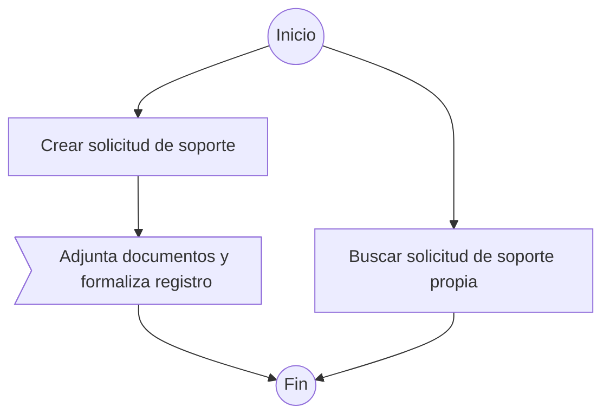

# Work Flow Behavior Diagram

**Responsabilidad documental:** VSlices Docs Standard.  
**Estado:** definición inicial candidata, derivada del diagrama interno de «Registro y seguimiento» de Serviu (2026-11-10).  
**Conceptos representados:** [Work Flow](../../../mechanisms/domain-modeling/concepts/work-flow.md), según [Domain Modeling](../../../mechanisms/domain-modeling/README.md).  
**Navegación:** [Diagramas](README.md).

## Definición

Un **Work Flow Behavior Diagram** es una representación examinable de **qué acciones, alternativas y relaciones internas reconocemos al realizar un Work Flow**, y de cómo se comprende su inicio y eventual término. Puede emplearse tanto para investigar el comportamiento como para **explicarlo mejor a otras personas**.

Su objeto es el **comportamiento dentro de un Work Flow**; no la coordinación entre Work Flows de un Work Process. No redefine las acciones organizacionales, no determina la implementación técnica y **no es obligatorio** para considerar comprendido un Work Flow.

## Elementos de lectura iniciales

| Elemento | Significado documental |
|---|---|
| **Inicio** | Punto desde el cual se leen los recorridos representados. No impone un evento de sistema, endpoint o disparador técnico. |
| **Acción interna** | Algo que se realiza dentro del Work Flow y tiene significado para el trabajo. No es automáticamente otro Work Flow ni una `System Action`. |
| **Conector dirigido** | Relación de continuación entre elementos del recorrido representado. La flecha no establece por sí sola duración, transacción, notificación ni mecanismo de ejecución. |
| **Recorridos alternativos** | Posibilidades de comportamiento distintas reconocidas dentro del mismo Work Flow. No requieren describir exhaustivamente todas las variantes. |
| **Fin** | Término del recorrido representado, no necesariamente cierre del Work Process, de un ticket o de cualquier otra entidad. |

### Acciones y alternativas

Las acciones pueden incluir registrar, consultar, evaluar o transformar información cuando **esas acciones forman parte del significado del Work Flow estudiado**. Los nombres y el número de acciones dependen del caso; no se debe crear una acción solo para llenar una figura.

Dos recorridos que parten de un inicio común **no implican que ambos deban ejecutarse**, ni que uno ocurra antes que el otro. Cuando la alternativa responde a una condición o decisión reconocida, la representación puede explicitarla. Cuando no existe evidencia de un criterio de decisión, no inventarlo.

### Límites del recorrido

El nodo **Fin** señala que termina la explicación de ese recorrido; no prueba por sí mismo que se haya completado toda la labor de la organización. Si una acción habilita otro Work Flow, esa **consecuencia** se explica mediante el modelo de coordinación del proceso o el texto del Work Flow, sin convertir necesariamente el otro Work Flow en un nodo de acción interna.

## Realización inicial en Mermaid

Para el caso observado se utiliza `flowchart TD`, con círculos para **Inicio/Fin**, rectángulos para las acciones y conectores dirigidos. Esta elección de formas y orientación **ilustra la realización actual**, no una gramática obligatoria para todo Work Flow Behavior Diagram. Una forma distinta no introduce por sí sola un nuevo tipo de entidad.

Se reproduce el diagrama elaborado en el Work Flow [«Registro y seguimiento» de Serviu](https://github.com/atom-dev-serviu/documentation/blob/main/organization/tickets/flows/registrar-solicitud-de-soporte.md), conservando su estructura:

**Lectura del ejemplo:** el solicitante puede crear una nueva solicitud o buscar una solicitud propia. El diagrama **no afirma** que buscar registre otra solicitud ni que obligue a realizar el otro recorrido. El registro formal habilita la continuación hacia «Evaluación de solicitudes», como se explica en el **Work Flow propietario** y en el **Work Process**. La búsqueda no provoca por sí misma ese avance.

Las formas específicas de Mermaid (incluido el nodo asimétrico `>` de «Adjunta documentos y formaliza registro» y los conectores `-->`/`--->`) se conservan como **elecciones de la realización de Serviu**. **No se les atribuye todavía una diferencia semántica normativa** que no haya sido establecida en el estudio. El motor gráfico no puede definir por sí mismo conceptos de dominio.

## Límites y conocimiento incompleto

- Representar solamente acciones, recorridos y relaciones sustentados, diferenciando afirmaciones, hipótesis y desconocimiento.
- La ausencia de una rama o retorno no prueba su imposibilidad. Tampoco la presencia de un único fin implica que todos los recorridos tengan idénticos efectos organizacionales.
- No derivar pantallas, autorizaciones, estados persistidos, contratos, temporización ni mecanismos de orquestación a partir de la figura.
- No elevar automáticamente acciones internas a Work Flows independientes. Revisar sus límites mediante Domain Modeling cuando exista evidencia que lo justifique.
- Mantener la **proyección del proceso** en el [Work Coordination Diagram](work-coordination-diagram.md) y la **proyección interna** en este diagrama. Ambas pueden complementar una explicación, pero no se sustituyen mutuamente.

## Separación de responsabilidades

- **Domain Modeling:** autoridad sobre el significado del Work Flow, las acciones organizacionales y el conocimiento observado.
- **Docs Standard:** convenciones de lectura para expresar su comportamiento de manera examinable y comunicable.
- **Caso particular:** documentación propietaria de Serviu, incluidas sus decisiones, preguntas abiertas y realización Mermaid.

El uso de este diagrama es **opcional**; la suficiencia del conocimiento depende de las preguntas y propósitos del estudio, no de haber dibujado todas las acciones.

## Preguntas abiertas

- ¿Qué distinciones adicionales entre decisiones, acciones y resultados requieren una convención gráfica propia al aparecer casos reales?
- ¿Cuándo conviene representar condiciones en conectores y cuándo una decisión explícita?
- ¿Qué otras realizaciones pueden preservar esta lectura sin depender de formas particulares de Mermaid?
